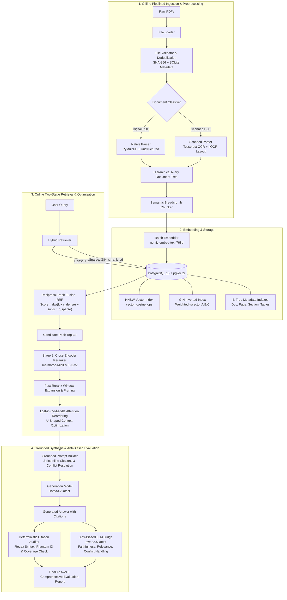

# Advanced Production RAG System

An end-to-end, enterprise-grade Retrieval-Augmented Generation (RAG) system engineered for complex technical documents (both digital PDFs and scanned images). The system features pipelined multiprocessing ingestion, layout-aware hierarchical document tree parsing, PostgreSQL pgvector hybrid search (Dense HNSW + Sparse GIN with Reciprocal Rank Fusion), Cross-Encoder reranking, "Lost in the Middle" attention optimization, strictly grounded synthesis, and an anti-biased LLM-as-a-Judge evaluation framework with deterministic citation auditing.

---

## Architecture Overview



---

## Models Used Across the System

| Pipeline Stage | Model / Tool | Architecture / Provider | Dimensionality / Config | Key Purpose |
| :--- | :--- | :--- | :--- | :--- |
| **OCR & Layout** | **Tesseract OCR (5.x)** | Tesseract / `pytesseract` | English (`eng`), hOCR output | Extracts text and per-word bounding box coordinates from scanned/raster PDFs to compute font statistics and structure. |
| **Dense Embeddings** | **`nomic-embed-text`** | Ollama | 768 dimensions | Vectorizes semantic chunks and incoming user search queries for dense similarity matching. |
| **Sparse Text Search** | **PostgreSQL Full-Text Search** | PostgreSQL 16 `tsvector` / `tsquery` | English dictionary, Stemming, Stopwords | Keyword search matching technical identifiers, arXiv IDs, and exact terminology. |
| **Stage 2 Reranker (Default)** | **`cross-encoder/ms-marco-MiniLM-L-6-v2`** | Hugging Face Transformers / PyTorch | Max length: 512, Sigmoid logit scoring | Performs full cross-attention over `[CLS] Query [SEP] Passage [SEP]` pairs to produce high-precision relevance scores. |
| **Stage 2 Reranker (Alternative)** | **`mxbai-embed-large:latest`** | Mixedbread AI / Ollama | 1024 dimensions, Query Prefix Prompt | Secondary high-capacity embedding reranker with task instruction prefixing. |
| **Answer Synthesis** | **`llama3.2:latest`** | Meta / Ollama | Local LLM Chat API | Synthesizes grounded responses with strict inline citations and explicit conflict reporting. |
| **Evaluation Judge** | **`qwen2.5:latest`** | Alibaba Cloud / Ollama | Local LLM (Decoupled from Generator) | Impartial evaluator scoring Faithfulness, Answer Relevance, and Conflict Handling with CoT reasoning. |

---

## Detailed Component Breakdown

### 1. Ingestion & Validation (`src/ingestion/`)
- **`LocalFileLoader`** (`loader.py`): Recursively traverses target directory structures, discovering PDF documents and streaming file paths into thread-safe multiprocessing queues.
- **`validator`** (`validator.py`):
  - Validates file existence, non-zero file size, PDF header integrity, and encryption status using `PyMuPDF`.
  - Calculates SHA-256 hashes to prevent redundant processing.
  - Interacts with a SQLite metadata store (`database/metadata_database.py`) to record processing states and logs corruption issues to `validator_issues.log`.

### 2. Document Classification (`src/preprocessing/classifier.py`)
- Distinguishes **`NATIVE`** (digitally created PDFs with text streams) from **`SCANNED`** (raster/image-only PDFs).
- Heuristic: If total character count across pages is below 50 characters, the document is routed to the scanned OCR pipeline; otherwise, it is treated as a native digital document.
- Detects presence of tables (`page.find_tables()`) and images (`page.get_images()`).

### 3. Layout-Aware Parsing & Document Hierarchy Tree (`src/preprocessing/`)
- **`NativeDocumentParser`** (`native_parser.py`):
  - Fast font-size statistical clustering with PyMuPDF to classify headings ($H_1, H_2, H_3$), narrative text, and lists.
  - Extracts structural tables into clean Markdown and HTML formats.
  - Extracts raster images with SHA-based persistent deduplication.
  - Fallback layout segmentation with `unstructured.partition.text`.
- **`ScannedDocumentParser`** (`scanned_parser.py`):
  - Uses Tesseract with hOCR XML output to obtain per-word font sizes and layout bounding boxes.
  - Computes page-level font histograms to reconstruct document headings, paragraphs, and captions on scanned documents.
- **`NaryTree` & `Node`** (`tree_buillder.py`):
  - Represents the entire document hierarchy as an N-ary tree preserving parent-child relationships, heading levels, and element lineages.

### 4. Semantic Breadcrumb Chunking (`src/preprocessing/chunker.py`)
- Solves the **orphan chunk problem** by walking the document tree and building contextual lineage.
- Prepends full ancestor breadcrumbs to chunk embeddings:
  ```
  [Document.pdf > 2. Methodology > 2.1 Neural Architecture]
  <Passage content...>
  ```
- Retains critical metadata per chunk: `doc_id`, `page`, `node_id`, `parent_id`, `parent_title`, `breadcrumb`, `has_table`, `table_markdown`, `has_image`, and `tree_path`.

### 5. Storage & Database Schema (`docker/init.sql`, `src/indexing/`)
- **Database**: PostgreSQL 16 with `pgvector`.
- **Table `documents`**: Master catalog tracking document IDs, filenames, tree paths, and total chunk counts.
- **Table `document_chunks`**: Stores raw text, breadcrumb-augmented `embed_text`, vector embeddings, table markdown, and image pointers.
- **Indexes**:
  - **Dense**: `HNSW` vector index (`vector_cosine_ops`, `m = 16`, `ef_construction = 64`) on `embedding vector(768)`.
  - **Sparse**: `GIN` inverted index on auto-generated `text_search_tsv` with weighted relevance:
    - **Weight A**: Section headings & breadcrumbs.
    - **Weight B**: Main body text and Markdown table cells.
    - **Weight C**: Captions.
  - **B-Tree**: High-speed metadata filtering indexes on `doc_id`, `doc_name`, `page`, `parent_id`, and `has_table`.

### 6. Two-Stage Hybrid Retrieval & Fusion (`src/retrieval/`)
- **Stage 1: Hybrid Retrieval (`hybrid_retriever.py`, `db_client.py`)**:
  - Executes dense vector cosine similarity search (`<=>`) and sparse keyword full-text search (`@@` with `ts_rank_cd`) in a **single database query**.
  - Merges dense and sparse ranks using **Reciprocal Rank Fusion (RRF)**:
    $$\text{RRF Score} = \frac{w_{\text{dense}}}{k + \text{rank}_{\text{dense}}} + \frac{w_{\text{sparse}}}{k + \text{rank}_{\text{sparse}}} \quad (\text{default } k = 60)$$
  - Dynamically configures `hnsw.ef_search`, enables `hnsw.iterative_scan`, and disables sequential scans for optimal index utilization.
- **Stage 2: Second-Stage Cross-Encoder Reranking (`reranker.py`)**:
  - Evaluates the top candidates (e.g., 30 chunks) using `cross-encoder/ms-marco-MiniLM-L-6-v2`.
  - Computes full cross-attention across queries and candidate passages to produce fine-grained semantic relevance scores.
- **Sibling Context Window Expansion**:
  - Optionally expands top chunks with adjacent chunks ($\pm N$) using hierarchical tree references to restore surrounding context.

### 7. Attention Optimization: "Lost in the Middle" (`orchestrator.py`)
- Mitigates the U-shaped attention degradation observed in large language models (where models attend well to the beginning and end of a context window, but overlook facts in the middle).
- **Reordering Strategy**:
  - **Rank #1** chunk is positioned at the **very beginning** (primacy effect).
  - **Rank #2** chunk is positioned at the **very end** (recency effect).
  - **Rank #3** and **Rank #4** are placed adjacent to the outer edges.
  - Lowest-ranked chunks are placed in the **center**.

### 8. Grounded Generation & Conflict Resolution Prompts (`prompts.py`)
- **Zero Hallucination Guardrails**: The LLM is instructed to answer strictly based on the provided reference blocks and explicitly state if information is insufficient.
- **Mandatory Inline Citations**: Every claim, metric, or statistic must have an immediate inline citation in the form `[Source X, Page Y]`.
- **Conflict Handling Protocol**:
  - If contradictory information exists across documents or sections, the model must **not** average or choose arbitrarily.
  - It must explicitly highlight the discrepancy (e.g., under a `"Discrepancy / Conflict Identified:"` section) and attribute each conflicting claim to its respective source and page.

### 9. Evaluation Framework & Deterministic Citation Auditor (`evaluator.py`)
- **Deterministic Citation Auditor (`audit_citations`)**:
  - Programmatic, rule-based audit (zero LLM bias).
  - Detects **phantom citations** (e.g., citing `[Source 5]` when only 3 sources were retrieved).
  - Calculates citation density (citations per 100 words) and source coverage.
- **Anti-Biased LLM-as-a-Judge (`RAGJudge`)**:
  - **Model Decoupling**: Uses a separate judge model (`qwen2.5:latest`) distinct from the synthesis model (`llama3.2:latest`) to prevent self-preference bias. Emits warnings if the same model is used for both roles.
  - **Double-Blind Anonymization**: The candidate answer is evaluated inside an anonymous tag without model attribution.
  - **Atomic Decomposition & CoT**: Forces chain-of-thought evidence extraction before generating numeric ratings for:
    1. **Faithfulness** (0.0 to 1.0)
    2. **Answer Relevance** (0.0 to 1.0)
    3. **Conflict Handling** (0.0 to 1.0)

---

## Directory Structure

```
.
├── docker/
│   └── init.sql                     # PostgreSQL schema, extensions, and HNSW/GIN indexes
├── docker-compose.yml               # pgvector PostgreSQL 16 container definition
├── src/
│   ├── config.py                    # Global configuration & database connection parameters
│   ├── rag_orchestrator.py          # Master CLI for end-to-end ingestion and querying
│   ├── database/
│   │   └── metadata_database.py     # SQLite cache for document ingestion & validation status
│   ├── ingestion/
│   │   ├── loader.py                # Local file scanner and queue feeder
│   │   └── validator.py             # PDF corruption, header check & SHA-256 deduplication
│   ├── preprocessing/
│   │   ├── classifier.py            # Native vs. Scanned PDF classifier
│   │   ├── native_parser.py         # PyMuPDF font-based layout parser
│   │   ├── scanned_parser.py        # Tesseract OCR & hOCR font size analyzer
│   │   ├── tree_buillder.py         # N-ary hierarchical document tree
│   │   ├── chunker.py               # Tree-to-chunk flattener with breadcrumbs
│   │   └── orchestrator.py          # Multiprocessing pipeline orchestrator
│   ├── indexing/
│   │   ├── embedder.py              # Ollama nomic-embed-text embedding client
│   │   ├── db_client.py             # PostgreSQL pgvector client & hybrid search queries
│   │   └── indexer.py               # Batch chunk embedder and database upsert worker
│   └── retrieval/
│       ├── hybrid_retriever.py      # Stage 1: Dual dense + sparse retrieval
│       ├── reranker.py              # Stage 2: Cross-Encoder & Mxbai rerankers
│       ├── prompts.py               # Strict grounding, citation, & conflict prompts
│       ├── evaluator.py             # Citation auditor & LLM-as-a-Judge framework
│       ├── pipeline.py              # Two-stage retriever pipeline wrapper
│       └── orchestrator.py          # Retrieval lifecycle, lost-in-middle, synthesis & evaluation
├── tests/                           # Comprehensive test suite covering all modules
└── validator_issues.log             # Log file tracking corrupt or rejected documents
```

---

## Setup & Getting Started

### 1. Prerequisites
- **Python**: `>= 3.10`
- **Docker & Docker Compose**: For PostgreSQL + pgvector
- **Tesseract OCR**: For scanned PDF processing
  ```bash
  sudo apt-get update && sudo apt-get install -y tesseract-ocr tesseract-ocr-eng libtesseract-dev
  ```
- **Ollama**: Installed and running locally (`http://localhost:11434`)
  ```bash
  # Pull required models
  ollama pull nomic-embed-text
  ollama pull llama3.2:latest
  ollama pull qwen2.5:latest
  ollama pull mxbai-embed-large:latest    # Optional alternative reranker
  ```

### 2. Environment Configuration
Start the PostgreSQL container with pgvector:
```bash
docker compose up -d
```
Default connection settings (in `src/config.py`):
```
Host: localhost
Port: 5434
Database: rag_db
User: rag_user
Password: rag_password
```

Install Python dependencies:
```bash
pip install -r requirements.txt  # or install dependencies inside your virtual environment
```

---

## Usage

### 1. Ingest & Index Documents
Place your PDF files into a directory (e.g., `data/`) and run the parallel ingestion pipeline:
```bash
python -m src.rag_orchestrator ingest --raw-dir data --output-dir output \
  --n-validators 4 \
  --n-classifiers 4 \
  --n-native 4 \
  --n-scanned 2 \
  --n-indexers 2
```

### 2. Query the Pipeline
Ask questions with grounded synthesis, inline citations, and automated evaluation:
```bash
python -m src.rag_orchestrator ask "What are the latency benchmarks reported for Model X?" \
  --top-k 5 \
  --expand-window 1 \
  --synthesis-model llama3.2:latest \
  --judge-model qwen2.5:latest \
  --evaluate
```

### 3. Programmatic Python API
```python
from src.rag_orchestrator import MasterRAGOrchestrator, RAGPipelineConfig

orchestrator = MasterRAGOrchestrator()

# Ingest and index
orchestrator.ingest_and_index(raw_dir="data", output_dir="output")

# Query with full evaluation report
result = orchestrator.ask(
    query="Compare the accuracy of baseline vs proposed architecture.",
    top_k=5,
    evaluate=True
)

print("Answer:\n", result["answer"])
print("Evaluation Metrics:\n", result["evaluation"])
```

---

## Testing

Run the test suite using `pytest`:
```bash
pytest tests/ -v
```
To run specific integration tests:
- **Hybrid Retrieval**: `pytest tests/test_hybrid_search.py -v`
- **Cross-Encoder Reranker**: `pytest tests/test_reranker.py -v`
- **Document Tree & Chunker**: `pytest tests/test_chunker.py tests/test_tree_builder.py -v`
- **Citation Auditor & LLM Judge**: `pytest tests/test_judge_evaluator.py -v`
